# 01-基础算法

## 归并排序求逆序对

```cpp
long long ans=0;   //逆序对总数，必须long long，防止溢出
int a[500010],t[500010]; //a原数组，t归并时临时辅助数组
// sort_：对区间[l,r]归并排序，同时统计逆序对
void sort_(int l,int r){
if(l>=r) return; //区间只有1个或没有元素，直接返回
int m=(l+r)/2;   //取中点，分治
sort_(l,m);      //递归处理左半区间 [l,m]
sort_(m+1,r);    //递归处理右半区间 [m+1,r]
int cur=l;   //t数组当前存放位置
int ll=l;    //左半部分指针
int rr=m+1;  //右半部分指针
//双指针合并两个有序子数组
while(ll<=m&&rr<=r){
if(a[ll]<=a[rr]){
t[cur]=a[ll];
```

cur++;

ll++;

```cpp
}
else{
// a[ll] > a[rr]：产生逆序对
// 左区间 ll~m 的全部元素都比a[rr]大，一共 m-ll+1 个逆序对
t[cur]=a[rr];
ans+=m-ll+1;
```

cur++;

rr++;

```cpp
}
}
//左半边剩下的直接复制进t
while(ll<=m){
t[cur]=a[ll];
```

cur++;

ll++;

```cpp
}
//右半边剩下的直接复制进t
while(rr<=r){
t[cur]=a[rr];
```

cur++;

rr++;

```cpp
}
//把合并好的有序区间，拷贝回原数组a
for(int i=l;i<=r;i++)
a[i]=t[i];
}
int main(){
ios::sync_with_stdio(false),cin.tie(0);
int n;
cin>>n;
for(int i=1;i<=n;i++)
cin>>a[i];
sort_(1,n);
cout<<ans;
return 0;
}
```

## 枚举

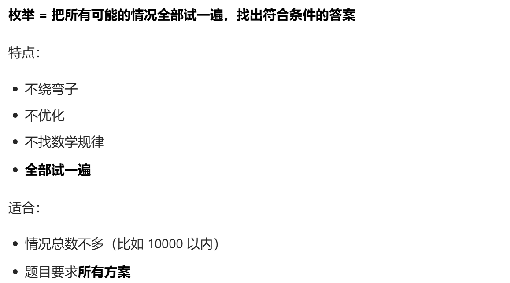

## 只要总数不大（<10 万），直接暴力枚举！

## 一般枚举都可以dfs,next_permutation

## unsigned

## 不要手动算 2^64,unsigned自动对 2^64取模

## 倍增法

## DFS

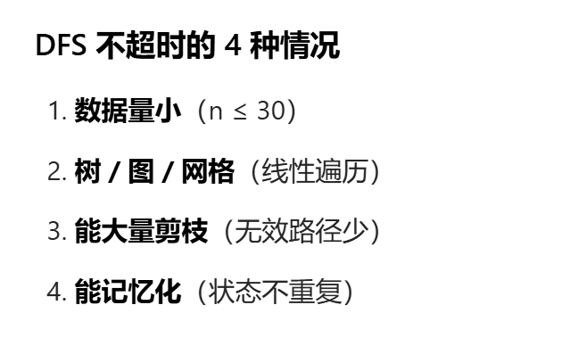

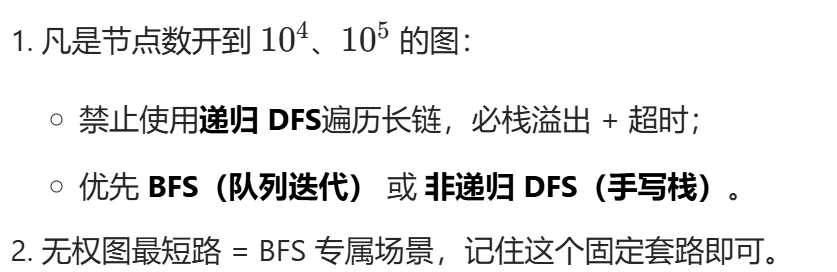

两次dfs就能求到树的直径

## dijkstra

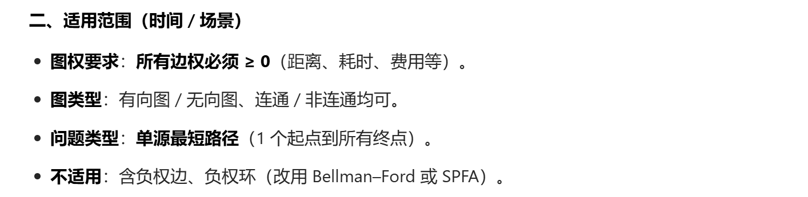

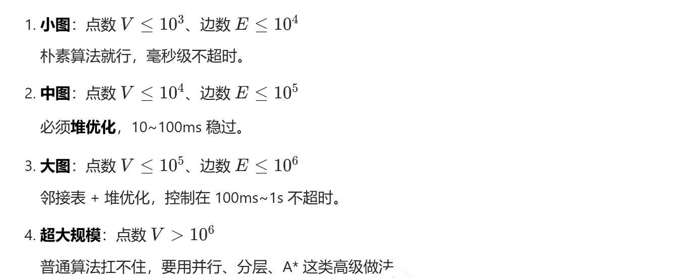

```cpp
//上面方法属于大图
```

## 二维前缀和

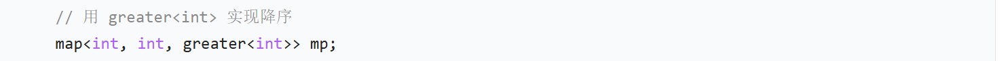

## 2的快速幂函数

## 两个高精度相乘

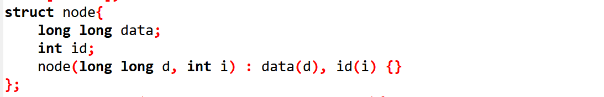

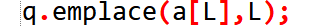

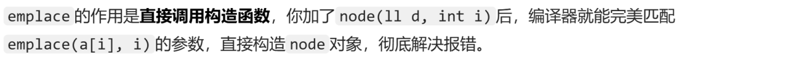

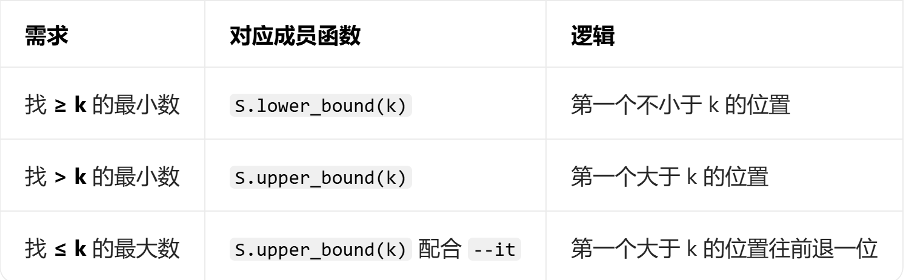

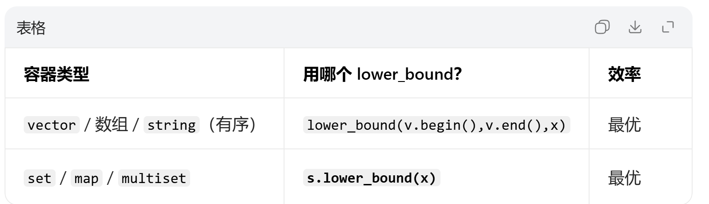

时间复杂度都是log n,但下面用上，时间复杂度就变成n

## 排序

## 输入

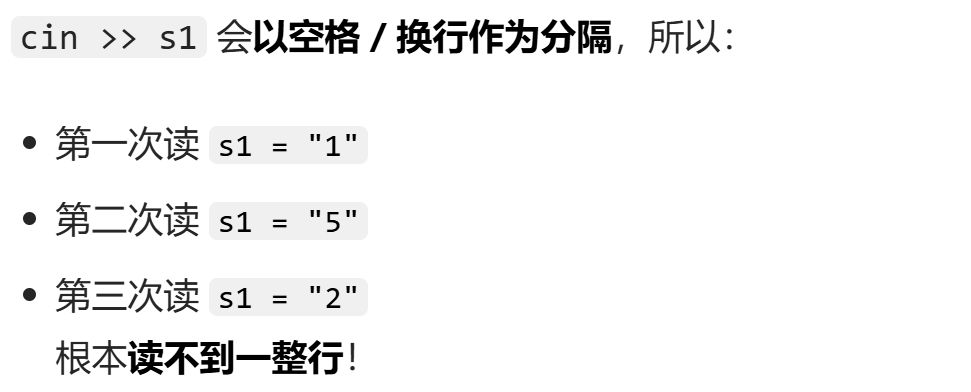

## 如果数组放在main函数里面，就会因为开空间太大，导致主函数无东西输出

```cpp
memset
```

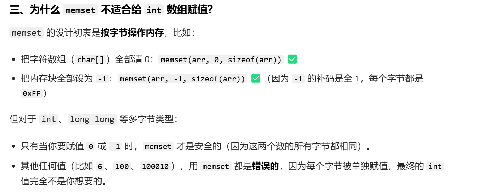

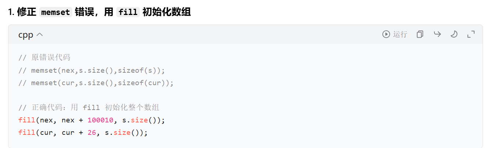
