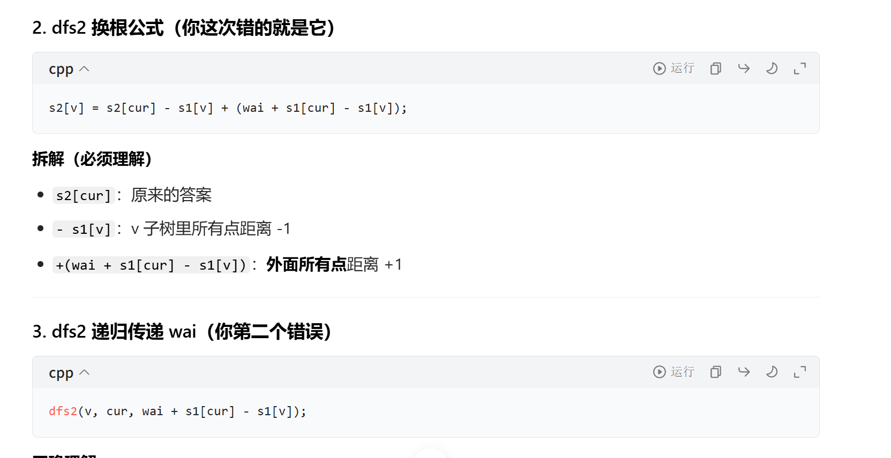

# 03-图论

## 链式前向星

普通图论小题，数据不大，用 vector 省事； 1e5 规模、网络流、Dinic，直接上链式前向星。

```cpp
// ======================链式前向星重点注释
const int MAXN = 1000010;   // 点的最大数量
int head[MAXN];     // head[u]：点u的第一条边在edge数组里面的下标
int edge_cnt = 0;           // edge数组用到第几条边，边计数器
// Edge结构体：存一条边的信息
struct Edge {
int to;     // 这条边指向哪个点 u ---> to
int nxt;    // nxt：同起点u的下一条边的下标；链表next指针
} edge[2000010]; // 无向图，每条边存2次，数组开2倍点数
/**
* @brief 加一条 u -> v 的单向边
* 模拟链表头插法：新边插到链表最前面
*/
void add_edge(int u, int v) {
```

edge_cnt++;                 // 边计数+1，拿到新边下标

```cpp
edge[edge_cnt].to = v;      // 设置这条边指向v
edge[edge_cnt].nxt = head[u]; // 新边的next指向u原来的第一条边
head[u] = edge_cnt;         // 更新head[u]：u的第一条边变成当前这条新边
}
/*
```

无向图怎么存？

u<->v等价：add_edge(u,v); add_edge(v,u);

插入两条单向边。

```cpp
*/
// =========链式前向星遍历邻边模板！！！=========
// i = head[u]：取出u的第一条边下标
// i = edge[i].nxt：跳到链表下一条边；i==0链表结束
for(int i = head[u]; i != 0; i = edge[i].nxt){
int to = edge[i].to; // 当前这条边指向的点
// 全局head数组全局默认初始化为0；竞赛建议手动
memset(head,0,sizeof head)
for(int i = 1; i <= n; i++){
int a;
cin >>  >> a;
add_edge(i, a);   // i -> a
add_edge(a, i);   // a -> i 无向图双向加边
}
```

## 内向基环树


## Kruskal 重构树


求图中两点之间，所有可行路径里，最大边权的最小值

跳跃并查集：右小优先，find 找空闲；用完 pos 跳 pos+1，永远小数指向大。

## 换根 DP





