# 07-STL与技巧

## 不同集合匹配最小次数

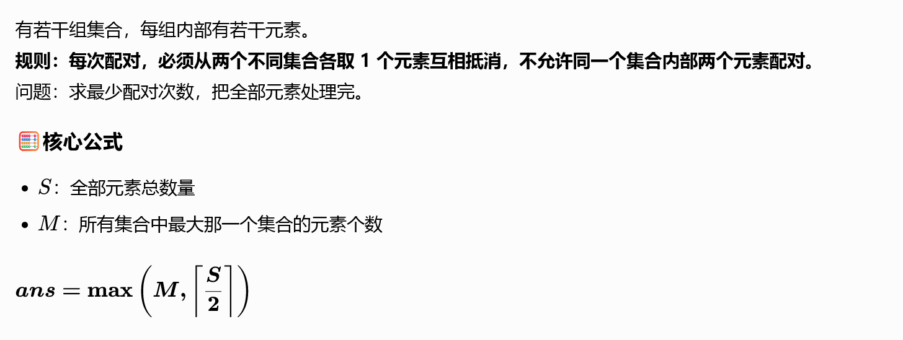

```cpp
ans = max(1LL * max_val, (sum + 1)/2);
```

三角形镜像补矩形，公式 (Ans=(ab+t)/2)。 先除 gcd 看互质；互质两数都奇数，t 取 gcd，否则 t 为 0。

=》

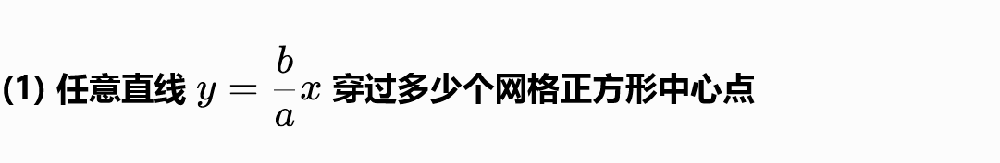

·  当且仅当 aa,bb 同时奇数：线段上一共有g个中心点。(gcd(aa,bb)==1),g=gcd(a,b)

·  否则：0 个中心点

## Short

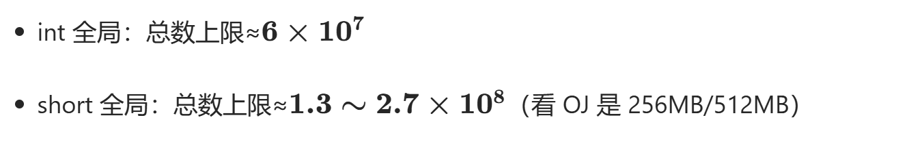

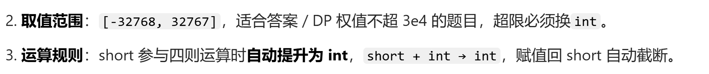

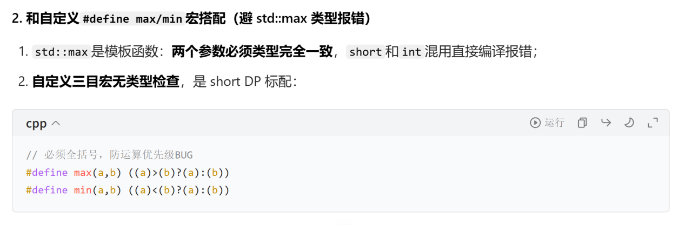

```cpp
memset(dp,0xc0,sizeof(dp)); // 全初始化为负无穷
E(X)
```

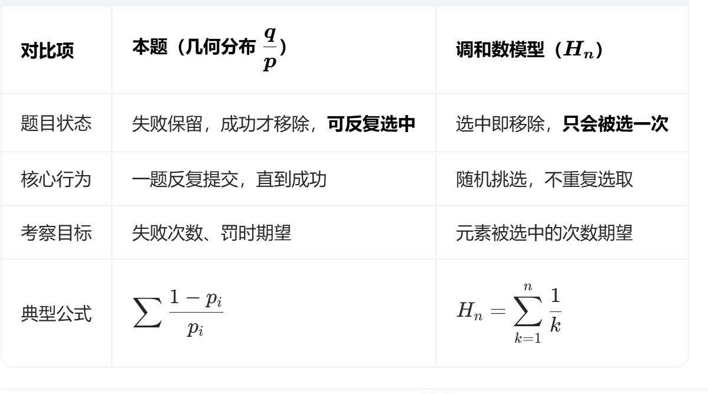

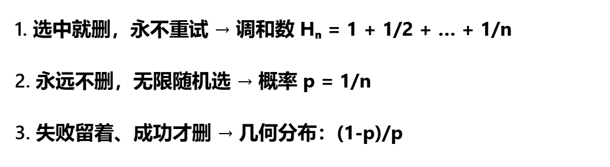

## 函数传数组问题

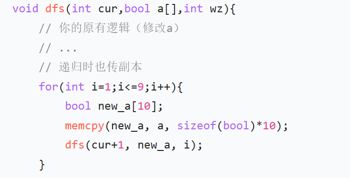

传的格式如图，然后记得要memcpy要不然函数里的变动会影响函数外的变动

## 左闭右开区间

```cpp
tuple<int, int, int>
```

## 数组维度

循环是小于1e8

## 小数题目

## Priority_queue

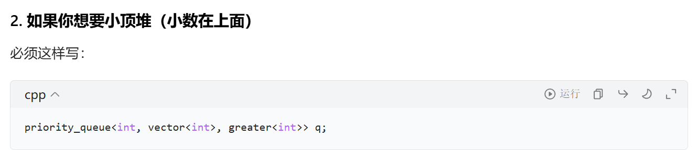

```cpp
map&&unordered_map
```

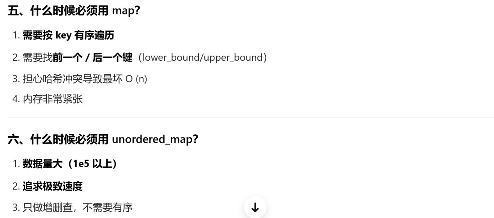

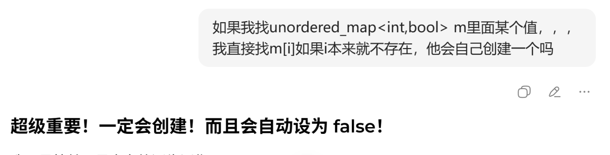

## 错误：

## 数组位置

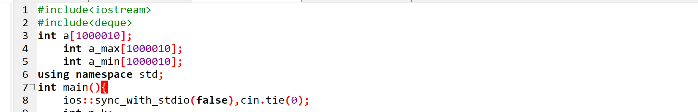

## Int 类型数组可用

```cpp
memset(dp1,0x80,sizeof(dp1)); //定义为小
memset(dp2,0x3f,sizeof(dp2));//定义为大
len[i]==0x3f3f3f3f
```

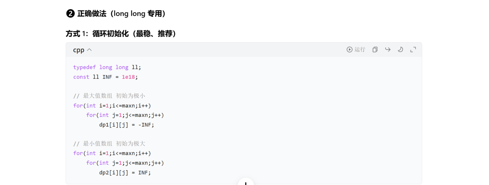

## 类型定义：

```cpp
int a[10];//a[i]取值小于1e
long long ans=ans*(a[i]*a[i])%Mod;//错误，因为(a[i]*a[i])可能大于int取值范围，因此得改为long long a[10]
```

## 思路：

## 4.有限小数规则（唯一规则）：约分后，分母只有 2 和 5 这两个质因子。

5.矩形第四个顶点坐标x4=(x1+x2)-x3,12号顶点与4号顶点相邻，y同理

6.环形问题 → 破环成链

## 队列
